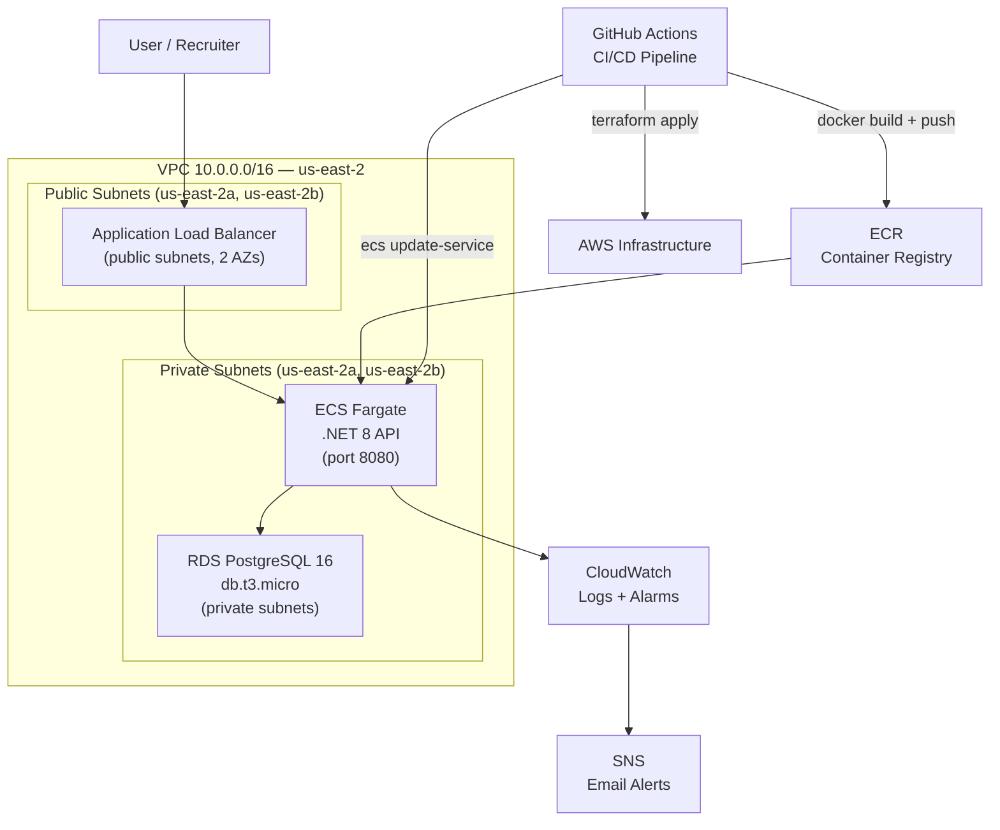
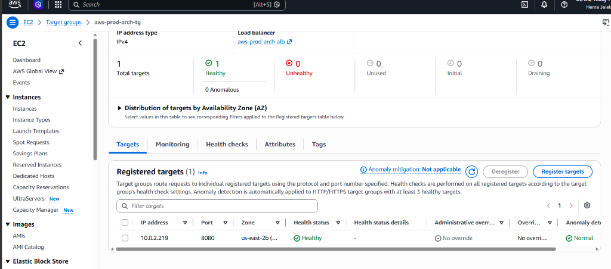
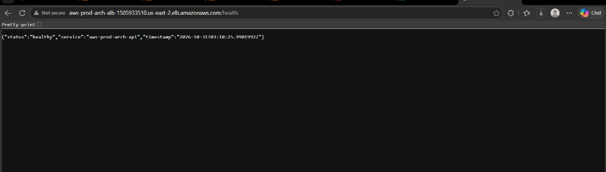
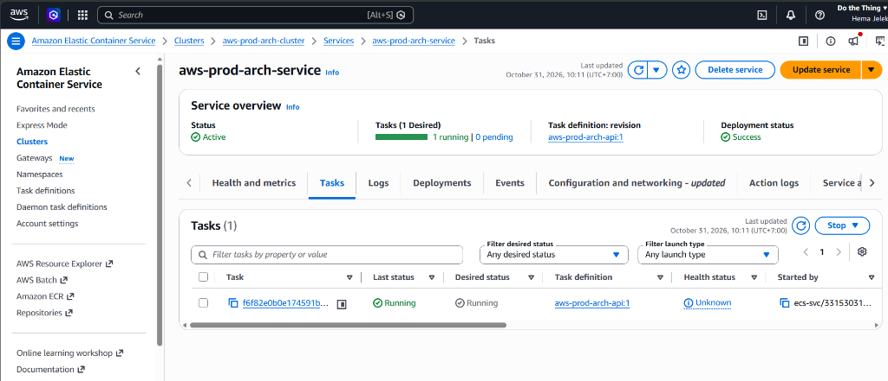
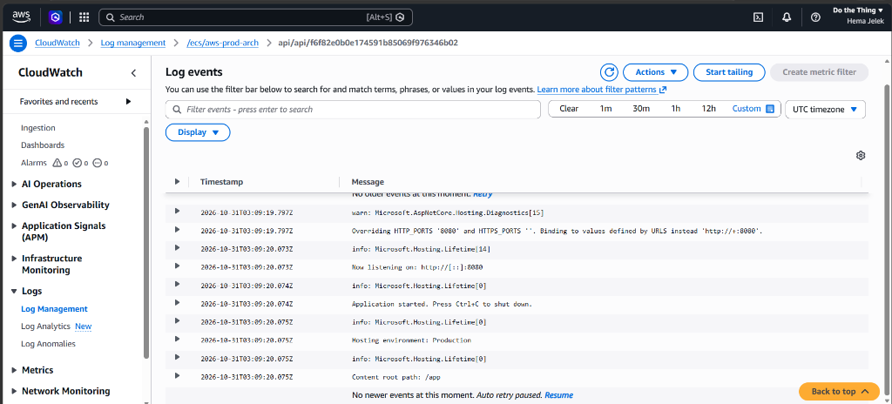
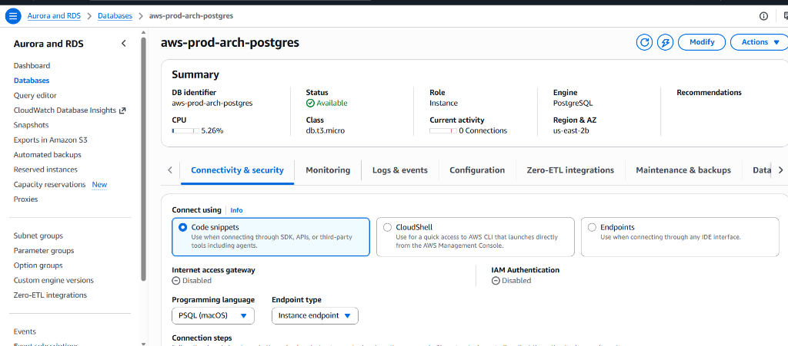
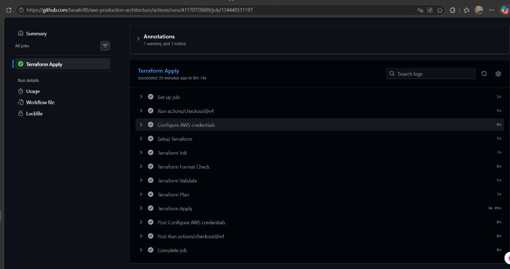

# AWS Production Architecture

Production-grade AWS infrastructure built with Terraform, demonstrating Cloud/DevOps engineering skills. Features containerized .NET 8 API deployed on ECS Fargate behind an ALB, with RDS PostgreSQL, CloudWatch monitoring, and fully automated CI/CD via GitHub Actions.

## Architecture



## Tech Stack

| Layer | Service | Purpose |
|-------|---------|---------|
| **Compute** | ECS Fargate | Serverless containers — no EC2 management |
| **Load Balancer** | ALB | HTTP routing, health checks, multi-AZ |
| **Database** | RDS PostgreSQL 16 | Managed DB, private subnet, encrypted |
| **Container Registry** | ECR | Private Docker image storage |
| **Networking** | VPC + Subnets + IGW | Isolated network, public/private separation |
| **Security** | Security Groups | ALB → ECS → RDS least-privilege access |
| **IaC** | Terraform | Modular, remote state (S3 + DynamoDB lock) |
| **CI/CD** | GitHub Actions | Auto plan on PR, auto apply on merge |
| **Monitoring** | CloudWatch + SNS | CPU/memory alarms, email notifications |
| **IAM** | ECS Execution/Task Roles | Least-privilege task permissions |
| **App** | .NET 8 Minimal API | Health endpoint + CRUD items API |

## Modules

```
infra/modules/
├── vpc/          VPC, subnets (2 public + 2 private), IGW, route tables
├── iam/          ECS execution role, ECS task role
├── security/     ALB security group, ECS security group
├── ecr/          ECR repository with scan-on-push
├── compute/      ALB, ECS cluster, ECS service, task definition, CloudWatch logs
├── database/     RDS PostgreSQL, DB subnet group, RDS security group
└── monitoring/   CloudWatch alarms (CPU, memory, RDS connections), SNS topic
```

## API Endpoints

| Method | Path | Description |
|--------|------|-------------|
| GET | `/health` | Health check — returns `{"status":"healthy"}` |
| GET | `/items` | List all items |
| POST | `/items` | Create item `{"name":"..."}` |
| DELETE | `/items/{id}` | Delete item by ID |

## CI/CD Pipeline

**`deploy-infra.yml`** — triggers on changes to `infra/`:
- `terraform fmt` → `terraform validate` → `terraform plan` (on PR)
- `terraform apply` (on push to main)

**`deploy-app.yml`** — triggers on changes to `app/`:
- `docker build` → push to ECR → `ecs update-service --force-new-deployment`

## Cost Analysis

| Service | Cost | Notes |
|---------|------|-------|
| ECS Fargate (0.25 vCPU, 0.5GB) | ~\$0.009/hr | Destroy after demo |
| ALB | ~\$0.022/hr | Destroy after demo |
| RDS db.t3.micro | **\$0** | Free tier 750hrs/mo (12 months) |
| ECR | **\$0** | Free tier 500MB/mo |
| VPC/Subnets/IGW | **\$0** | Always free |
| S3 (tfstate) | **\$0** | <1MB, negligible |
| DynamoDB (lock) | **\$0** | On-demand, <1 req/day |
| CloudWatch | **\$0** | Free tier covers logs + alarms |
| **Between sessions** | **\$0.00** | Only ALB+ECS cost money; destroyed after each demo |

## Screenshots

| Screenshot | Description |
|------------|-------------|
|  | Target group — 1 healthy target at port 8080 |
|  | `/health` endpoint returning JSON via ALB |
|  | ECS service — 1 running task, deployment success |
|  | App logs — .NET 8 startup, listening on port 8080 |
|  | RDS PostgreSQL — available, private subnet, encrypted |
|  | CI/CD pipeline — all steps green |

## Key Design Decisions

- **Public subnets for ECS** — NAT Gateway costs ~\$32/mo. ECS in public subnet with `assign_public_ip=true` avoids this cost while keeping RDS in private subnet. Upgrade path: add ECR/S3 VPC endpoints + move ECS to private subnet.
- **Remote Terraform state** — S3 backend with DynamoDB locking prevents concurrent apply conflicts (critical for team environments).
- **Modular Terraform** — each concern (VPC, IAM, compute, database, monitoring) is an independent module. Compose at root level.
- **Destroy after demo** — ALB+ECS+RDS destroyed after each session. VPC/IAM/ECR/SGs left (all free).

## Usage

```bash
# Deploy infra
cd infra
terraform init
terraform apply -var="db_password=<secret>"

# Deploy app
cd app
docker build -t <ecr-url>/aws-prod-arch-api:latest .
docker push <ecr-url>/aws-prod-arch-api:latest
aws ecs update-service --cluster aws-prod-arch-cluster --service aws-prod-arch-service --force-new-deployment

# Destroy (always run after demo)
terraform destroy -target=module.compute
terraform destroy -target=module.database
```

## Author

Cloud/DevOps Engineer — 5yr .NET/Azure background, transitioning to AWS.
Skills: AWS · Terraform · ECS Fargate · Docker · GitHub Actions · .NET 8 · Kubernetes · Azure
